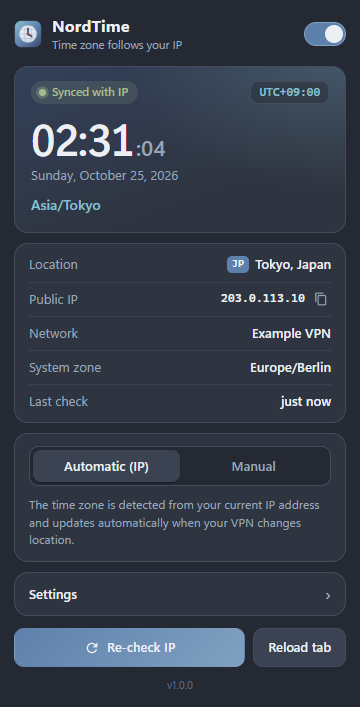
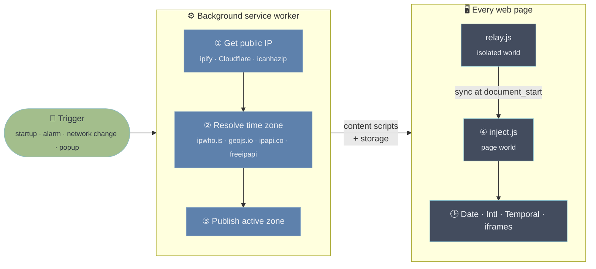

<p align="center">
  
</p>

<h1 align="center">NordTime</h1>

<p align="center">
  <b>Your browser's time zone, automatically matched to your VPN location.</b><br>
  A Manifest V3 extension for Chrome, Edge, Brave, Opera and other Chromium browsers.
</p>

<p align="center">
  
  
  
</p>

---

When you connect to a VPN, websites see an IP address in another country, but your browser still reports
your **real** time zone through JavaScript (`Date`, `Intl.DateTimeFormat`, …). That mismatch is one of the
easiest ways for a site to tell that you are using a VPN.

NordTime fixes it. It checks the public IP address your browser is using, looks up where that IP is located,
and makes every website see the time zone of that location. When the VPN switches servers, NordTime notices
and follows automatically.

<p align="center">
  
</p>

## Features

- **Fully automatic.** Detects your public IP on startup, every minute (configurable), and right away when the
  network changes (VPN connect, disconnect or server switch).
- **Applied before the page runs.** The zone is in place before the first inline `<script>` on the page runs,
  so scripts that check early still see the spoofed zone.
- **Live switching.** Open tabs follow a new location immediately, without a reload.
- **Thorough coverage.** `Date` getters and setters, `getTimezoneOffset`, `toString` and friends,
  `toLocale*String`, the `Date` constructor and `Date.parse` for local-time strings,
  `Intl.DateTimeFormat`/`resolvedOptions()`, `Temporal.Now`, and same-origin iframes, including iframes
  that a page script creates and reads straight away.
- **Hard to detect.** Patched functions keep their native `name`, `length` and `toString()` output
  (`function getHours() { [native code] }`). Subclassing `Date` and `instanceof` still work.
- **Correct daylight saving time.** Offsets are computed per instant from the browser's own time zone data.
- **Manual override.** Pin any of the ~420 IANA time zones from a searchable list.
- **Resilient lookups.** Four geolocation providers with automatic fallback. The last known location is kept
  if all of them fail.
- **Badge and notifications.** The toolbar badge shows the current country code, and an optional desktop
  notification tells you when the zone changes.

## Installation

### From source (developer mode)

1. Download this repository ([ZIP from Releases](../../releases) or `git clone`).
2. Open `chrome://extensions` (or `edge://extensions`).
3. Turn on **Developer mode**.
4. Click **Load unpacked** and select the `NordTime` folder (the one that contains `manifest.json`).
5. Pin NordTime to the toolbar. It starts working at once.

## How it works



| Step | What happens |
| :---: | --- |
| **① Detect** | The service worker gets the public IP. The request goes through the browser, so it shows the VPN exit IP, whether the VPN runs as a system app or as a browser proxy extension. |
| **② Resolve** | The IP is turned into an IANA time zone, with four providers as fallbacks. The location is looked up again only when the IP changes, or every 6 hours. |
| **③ Deliver** | `chrome.storage` is asynchronous and would lose the race against inline page scripts. Instead, NordTime registers its content scripts with a few one-line files (`src/content/zone/bitN.js`) that encode the zone's index in `Intl.supportedValuesOf('timeZone')`. The relay therefore knows the zone **synchronously** at `document_start`. |
| **④ Spoof** | `inject.js` runs in the page's main world. It calculates wall-clock time in the target zone with `Intl.DateTimeFormat#formatToParts` and caches the results. All hooks fall back to native behavior when NordTime is disabled. |

## Privacy

- NordTime has **no analytics and no servers of its own**.
- The only network requests it makes are the IP and geolocation lookups listed above. They are sent without
  cookies or a referrer.
- Everything it stores (settings, last location) stays in `chrome.storage.local` on your device.

### Permissions

| Permission | Why |
| --- | --- |
| `<all_urls>` host access | Apply the time zone on every site and call the lookup APIs |
| `scripting` | Register the content scripts that carry the current zone |
| `storage` | Settings and last known location |
| `alarms` | Periodic IP check |
| `webRequest` | Notice network changes (`ERR_NETWORK_CHANGED`) when a VPN connects or disconnects |
| `notifications` | Optional "time zone changed" notification |

## Limitations

- Web Workers and Service Workers use the real system zone. JavaScript in the page itself, which is what
  nearly all sites check, is covered.
- Changing the time zone does not change other location signals, such as `Accept-Language`, WebRTC or
  geolocation. Use your VPN's own leak protection for those.
- Cross-origin iframes are covered by their own content-script instance, not by the parent page's hooks.

## Development

```bash
npm install
npx playwright install chromium
npm test                    # end-to-end test in Chromium with the extension loaded
CHANNEL=msedge npm test     # run the tests in Microsoft Edge instead
npm run icons               # re-render icons/*.png from icons/icon.svg
npm run package             # build dist/nordtime-v<version>.zip
```

The end-to-end suite (`tests/e2e.mjs`) loads the unpacked extension and checks:

- real IP detection;
- more than 20 time zone behaviors each for `Asia/Tokyo` and `America/New_York` (including DST);
- live switching, and the disabled state;
- a simulated VPN server change (mocked IP that resolves to Tokyo).

### Project layout

```
manifest.json
src/
  background.js        IP detection, geolocation, alarms, badge, content script registration
  content/inject.js    page-world time zone shim
  content/relay.js     isolated-world bridge (storage → page)
  content/zone/*.js    synchronous zone encoding (see "How it works")
  popup/               toolbar popup UI
icons/                 SVG source + PNG renders
tests/e2e.mjs          Playwright end-to-end tests
```

## License

[MIT](LICENSE). NordTime is an independent project. It is not affiliated with Nord Security or NordVPN.
The color scheme is based on the open-source [Nord](https://www.nordtheme.com) palette.
